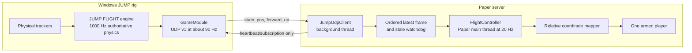

# JUMP Minecraft Flight Bridge

A small Paper plugin that makes one Minecraft player follow the authoritative
position and orientation emitted by the JUMP FLIGHT engine. JUMP continues to
own all wingsuit and landing physics. Minecraft is only a renderer and does not
apply Elytra, gravity, velocity, terrain collision, or other flight physics.

The MVP supports one explicitly armed player, JUMP UDP protocol v1, lifecycle
tracking, relative coordinate mapping, stale-packet safety, deterministic
synthetic flight, and restoration of the player's normal movement state.

It does **not** implement world uploads, custom launchpads, landing zones,
Minecraft-to-JUMP collision feedback, or a client mod.

## Current status and landing limitation

The source investigation confirmed JUMP's position-authoritative UDP stream and
physical launch transitions. It did not confirm the requested production
Space-to-landing action:

- Space in JUMP desktop/test mode starts a jump.
- `P` in desktop/test mode starts player-controlled canopy deployment.
- The normal physical FLIGHT console does not bind Space.
- A complete scripted landing requires the existing `setLandingTarget` command
  with a JUMP-world target position and heading.
- The player-controlled `canopy_flying` path has no confirmed automatic
  transition to `landed` in the available source.

This plugin does not invent a landing command. It follows `pre_deployed`,
`deployed`, `canopy_flying`, and `landed` when JUMP emits them. The facility
test must establish which unavailable FLIGHT/launcher component, if any,
handles Space when Unreal is not running.

See [analysis.md](analysis.md) for the source evidence and full feasibility
report.

## Architecture



The UDP thread performs socket I/O and parsing only. Entity and world methods
are called from the Paper main thread. At each server tick, the controller uses
the newest timestamped JUMP frame rather than replaying all 90 Hz samples.

## Requirements

- Minecraft Java Edition 26.3 server and client.
- PaperMC 26.3.
- Java 25, matching this host's current runtime and build configuration.
- The checked-in Gradle 9.8.1 wrapper (no system Gradle installation needed).
- Python 3 for the deterministic synthetic sender.
- An authorized IPv4 path from Paper to the Windows FLIGHT host for facility
  use. Tailscale is suitable when explicitly approved and restricted.

Official references:

- [Paper getting started](https://docs.papermc.io/paper/getting-started/)
- [Paper plugin project setup](https://docs.papermc.io/paper/dev/project-setup/)
- [Paper downloads](https://papermc.io/downloads/paper)
- [Gradle installation](https://docs.gradle.org/current/userguide/installation.html)
- [Eclipse Temurin Java downloads](https://adoptium.net/temurin/releases/)
- [LinuxGSM Minecraft Java server](https://linuxgsm.com/servers/mcserver/)

This project compiles against the real published API coordinate
`io.papermc.paper:paper-api:26.3.build.224-stable`. The installed server reports
Paper `26.3-224-main@eb9098a` and API `26.3.build.224-stable`. Paper's current
`plugin.yml` documentation lists `api-version: '26.3'` as valid.

## Build

Install a Java 25 JDK, then use the checked-in wrapper:

```bash
cd /home/akmod/code/jump_minecraft
java -version
./gradlew --version
./gradlew clean check jar
```

Expected artifact:

```text
build/libs/jump-minecraft-0.1.0.jar
```

The build resolves the real Paper API from Paper's Maven repository. It never
falls back to local API stubs. Paper is `compileOnly` for the production code;
the server supplies it at runtime. JUnit runs seven core test methods containing
36 assertions and two Paper-controller test methods containing 12 assertions.
Run the Python sender tests separately:

```bash
python3 -m unittest discover -s tools -p 'test_*.py' -v
```

## Configuration

On first start Paper copies `config.yml` to:

```text
/home/mcserver/serverfiles/plugins/JumpMinecraft/config.yml
```

Defaults:

```yaml
flight:
  host: "127.0.0.1"
  port: 1201
  local-bind-host: "0.0.0.0"
  local-port: 0
  heartbeat-interval-millis: 1000
  subscription-expiry-seconds: 3.0
  socket-timeout-millis: 200
  stale-after-millis: 1000

movement:
  blocks-per-meter: 1.0
  heading-offset-degrees: 0.0
  max-step-blocks: 20.0
```

`flight.host` and `flight.port` are the explicitly configured FLIGHT endpoint.
The plugin does not assume that a remote Windows machine is reachable. It logs
a warning when the endpoint is loopback.

`local-port: 0` is intentional. The operating system selects an ephemeral port,
and the plugin sends heartbeats and receives replies through that same socket.
JUMP identifies a subscriber by source IP and source port.

`max-step-blocks` rejects an unsafe discontinuity. The MVP also disengages if a
destination chunk is not already loaded rather than synchronously generating a
chunk and stalling the server.

## Commands

The `jump.control` permission defaults to operators.

```text
/jump arm
/jump arm <online-player>
/jump disarm
/jump status
```

`/jump arm` designates one player but does not issue a JUMP launch command. On
`jumping`, the plugin captures the player's Minecraft location, world, and yaw
and disables Minecraft gravity/velocity. On the first `flying` frame it captures
the JUMP origin and begins applying relative displacement.

The controller follows `flying`, `pre_deployed`, `deployed`, and
`canopy_flying`. It restores the original player state on `landed`, return to
`preparing` after launch, stale UDP input, discontinuity, unloaded destination,
world change, disarm, disconnect, kick, or plugin shutdown.

## LinuxGSM and Paper installation

For a new Ubuntu host, install the base tools and Java 25, create the service
account, and bootstrap LinuxGSM:

```bash
sudo apt update
sudo apt install -y ca-certificates curl tmux unzip python3 openjdk-25-jdk
sudo adduser --disabled-password --gecos "" mcserver
sudo -iu mcserver bash -lc \
  'curl -Lo linuxgsm.sh https://linuxgsm.sh && chmod +x linuxgsm.sh && bash linuxgsm.sh mcserver'
sudo -iu mcserver /home/mcserver/mcserver install
```

LinuxGSM installs vanilla Minecraft by default. Installing Paper is a separate
server-administration step: download Paper 26.3 from the official Paper service,
place it in the LinuxGSM server directory using the executable name configured
by that installation, accept Mojang's EULA, and confirm `mcserver details`
reports Paper 26.3 build 224. Do not overwrite an existing server JAR without a
backup. This repository assumes that setup already exists.

The expected existing LinuxGSM layout is:

```text
/home/mcserver/mcserver
/home/mcserver/serverfiles/
/home/mcserver/serverfiles/plugins/
```

Confirm it without changing the running server:

```bash
sudo -iu mcserver /home/mcserver/mcserver details
sudo -iu mcserver find /home/mcserver/serverfiles -maxdepth 2 \
  \( -type f -name 'paper*.jar' -o -name 'server.properties' \) -print
```

Build, back up any prior plugin, and install the verified artifact:

```bash
cd /home/akmod/code/jump_minecraft
./gradlew clean check jar
sudo -iu mcserver mkdir -p /home/mcserver/serverfiles/plugins/backup
if sudo -iu mcserver test -f /home/mcserver/serverfiles/plugins/jump-minecraft.jar; then
  sudo -iu mcserver cp -a \
    /home/mcserver/serverfiles/plugins/jump-minecraft.jar \
    /home/mcserver/serverfiles/plugins/backup/jump-minecraft.jar.pre-0.1.0
fi
sudo install -o mcserver -g mcserver -m 0644 \
  build/libs/jump-minecraft-0.1.0.jar \
  /home/mcserver/serverfiles/plugins/jump-minecraft.jar
```

Paper loads plugins at server startup. In an approved maintenance window:

```bash
sudo -iu mcserver /home/mcserver/mcserver stop
sudo -iu mcserver /home/mcserver/mcserver start
sudo -iu mcserver /home/mcserver/mcserver console
```

Do not use `/reload`; a clean restart is safer for socket-owning plugins.
After startup, inspect `/home/mcserver/serverfiles/logs/latest.log` for
`JUMP Minecraft bridge enabled` and absence of `Could not start JUMP bridge` or
plugin-load exceptions. In the LinuxGSM console, run `plugins`, `help jump`, and
`jump status`; leave the console with `Ctrl+B`, then `D` (not `Ctrl+C`).

To roll back, stop the server, replace the plugin with the backup, and start it:

```bash
sudo -iu mcserver /home/mcserver/mcserver stop
sudo -iu mcserver cp -a \
  /home/mcserver/serverfiles/plugins/backup/jump-minecraft.jar.pre-0.1.0 \
  /home/mcserver/serverfiles/plugins/jump-minecraft.jar
sudo -iu mcserver /home/mcserver/mcserver start
```

After the first approved start, edit the generated config as `mcserver`, then
perform another approved clean restart:

```bash
sudo -iu mcserver nano \
  /home/mcserver/serverfiles/plugins/JumpMinecraft/config.yml
```

## Synthetic Linux flight test

For a same-host synthetic test, leave `flight.host` as `127.0.0.1` and
`flight.port` as `1201`.

1. Join the Paper server and stand in a spacious area with nearby chunks loaded.
2. Run `/jump arm` in Minecraft.
3. On the Linux server, start:

```bash
cd /home/akmod/code/jump_minecraft
python3 tools/synthetic_flight.py --host 127.0.0.1 --port 1201 --rate 90
```

The sender acts as GameModule: it binds port 1201, waits for the plugin's
heartbeat, and returns deterministic `preparing`, `jumping`, `flying`,
`pre_deployed`, `deployed`, and `landed` frames. The player should follow a
turning descending path, then regain normal control at `landed`.

Use `/jump status` to see the designated player, lifecycle state, last frame,
accepted/rejected datagram counts, local UDP endpoint, and last socket error.

Automated tests:

```bash
./gradlew clean check jar
python3 -m unittest discover -s tools -p 'test_*.py' -v
```

## Connecting the real Windows FLIGHT engine

JUMP GameModule binds a local address; it does not initiate a connection to
Paper. The plugin sends a subscription heartbeat to that address, and FLIGHT
replies to the heartbeat's source endpoint.

On the production FLIGHT configuration, protocol v1 requires:

```ini
[game]
enable = true
host = <Windows machine's authorized/Tailscale IPv4 address>
port = 1201
rate = 90
gameframe_version = 1
```

Configure Paper with that same Windows IPv4 address:

```yaml
flight:
  host: "<Windows authorized/Tailscale IPv4 address>"
  port: 1201
```

Important restrictions:

- `127.0.0.1` accepts only clients on the Windows FLIGHT machine.
- JUMP's address parser expects dotted IPv4, not a DNS name or IPv6.
- Desktop mode refuses a non-loopback game bind. A desktop test with remote
  Paper needs an approved localhost UDP relay or recorded-frame replay.
- Changing `gameframe_version` affects the one GameModule stream globally.
- The protocol is unauthenticated. Permit UDP 1201 only from Paper's authorized
  address/Tailscale identity, and never expose it to the public Internet.

Official networking references:

- [Tailscale installation](https://tailscale.com/kb/installation)
- [Tailscale access controls](https://tailscale.com/kb/1018/acls)
- [Microsoft Defender Firewall](https://learn.microsoft.com/windows/security/operating-system-security/network-security/windows-firewall/)

Before involving hardware, verify the endpoint on Windows:

```powershell
Get-NetUDPEndpoint -LocalPort 1201
```

`tailscale ping <windows-name-or-ip>` validates the Tailscale path but not UDP
port 1201. `/jump status` and FLIGHT's subscription logs provide the
protocol-level check.

### UDP v1 versus v2

Version 1 is JSON and includes `findex`, lifecycle state, `pos`, `forward`,
`up`, tracking status, speed, and tracker data. It is portable and is the only
version decoded by this plugin.

Version 2 sends a native C++ `GameFrame2` layout followed by optional JSON. Its
binary size is self-described, but compiler padding, endianness, and ABI are not
formally portable.

Subscription heartbeat:

```json
{"findex":1793040000000000,"expiresInSeconds":3.0,"helicopterFlag":false}
```

The plugin sends no launch, landing, reset, calibration, collision, or physics
commands.

## Minecraft Java Edition 26.3 client

1. Install the official [Minecraft Launcher](https://www.minecraft.net/download).
2. Sign in with the licensed Microsoft account.
3. Create or select a Java Edition installation for exactly Minecraft 26.3.
4. Launch it once unmodified and confirm it can join Paper.
5. In Multiplayer, add Paper's authorized LAN/Tailscale address and normal
   Minecraft port, usually 25565.

The Minecraft and FLIGHT connections are separate: the client connects to
Paper, while the Paper plugin connects to FLIGHT.

## Fabric and Vivecraft 26.3 client

Vivecraft is optional. Validate the bridge with a standard desktop client first.

Official projects:

- [Fabric installer](https://fabricmc.net/use/installer/)
- [Fabric documentation](https://docs.fabricmc.net/)
- [Vivecraft downloads](https://www.vivecraft.org/downloads/)
- [Vivecraft source and releases](https://github.com/Vivecraft/VivecraftMod)

Installation outline:

1. Download the official Fabric Installer for Windows. Close Minecraft and its
   launcher, run the installer, select Minecraft 26.3, and keep `Create Profile`
   selected.
2. Start the generated Fabric profile once, then close Minecraft.
3. Download the current 26.3 Vivecraft release from the official releases page.
   Release `26.3-1.3.17` is the current official release observed on
   2026-10-26; use its
   Fabric asset and follow the release's dependency list rather than guessing.
   Do not use a Forge or NeoForge asset in a Fabric profile.
4. Put the exact 26.3 Vivecraft mod and dependencies listed by that official
   release into the profile's `mods` directory.
5. Launch Fabric, confirm Vivecraft loads, and test joining Paper before using
   the physical rig.

Do not assume Fabric API or another dependency is required or optional; follow
the selected official Vivecraft release's dependency list.

## SteamVR and headset setup

- Install [SteamVR](https://store.steampowered.com/app/250820/SteamVR/) and the
  runtime required by the headset vendor.
- Complete headset room/standing calibration before launching Vivecraft.
- Confirm controllers and headset tracking in SteamVR Home first.
- Configure Vivecraft for standing play and avoid locomotion controls that
  cause unintended movement while the server is position-authoritative.
- Preserve all physical JUMP harness, operator, clear-area, and emergency
  procedures.

Vivecraft client tracking and JUMP FLIGHT tracking are separate systems. Their
coexistence, coordinate alignment, performance, and driver behavior have not
been tested. Do not rely on coexistence until a controlled facility test proves
it.

## Facility checklist

- [ ] Synthetic flight passed and restored player state.
- [ ] The plugin was rebuilt against the real installed Paper API.
- [ ] Paper starts without plugin/API errors.
- [ ] `/jump status` reports the intended endpoint and fresh frames.
- [ ] Windows FLIGHT binds the authorized IPv4 interface, not loopback.
- [ ] Firewall/Tailscale ACL permits UDP 1201 only from Paper.
- [ ] FLIGHT emits v1 JSON.
- [ ] Unreal is not running when Minecraft is the selected environment.
- [ ] Tracker/stage calibration works without Unreal.
- [ ] Navigator readiness and any localhost interlock remain healthy.
- [ ] The Minecraft player is in a spacious, loaded area.
- [ ] `/jump arm` is issued before launch.
- [ ] Physical launch yields `preparing -> jumping -> flying` without a
      Minecraft launch command.
- [ ] Minecraft follows the relative trajectory.
- [ ] Technician Space is correlated with FLIGHT logs or an authorized capture.
- [ ] Identify whether Space produces `setLandingTarget`, `triggerCanopy`, or
      nothing.
- [ ] Confirm `pre_deployed -> deployed -> landed` before treating landing as
      supported.
- [ ] Confirm restoration after `landed` and an intentional stale-stream test.
- [ ] Keep `/jump disarm` and existing physical emergency controls available.

## Troubleshooting

### No UDP frames

- Check `/jump status` for the local socket and last error.
- On Windows run `Get-NetUDPEndpoint -LocalPort 1201`.
- Confirm `gameframe_version = 1`; binary v2 is rejected.
- Confirm a remote FLIGHT bind is not `127.0.0.1`.
- Use a dotted IPv4 address.
- Check Windows Firewall and Tailscale ACLs.
- FLIGHT heartbeats require `findex`, `expiresInSeconds`, and
  `helicopterFlag: false`; the plugin sends all three.

### Frames arrive but launch never begins

- Run `/jump arm` for the intended online player.
- Inspect `/jump status` for the lifecycle state.
- Check FLIGHT logs for Navigator readiness, calibration, tracking, and the
  500 ms healthy-input gate.
- Never bypass readiness, tracking, calibration, or hardware safety checks.

### Player immediately disengages

- Read the player's release message and server log.
- Load the destination area before testing.
- Increase `max-step-blocks` only after proving the discontinuity is legitimate.
- Check for world changes, packet stalls, or a return to `preparing`.

### Correct but visually stepped movement

- Paper applies at 20 server ticks per second while JUMP normally emits 90 Hz.
- Check server TPS and packet loss first.
- Keep newest-frame sampling; do not queue old frames.
- Client mods or packet-level interpolation are outside this MVP.

### Vivecraft or headset tracking problems

- Reproduce with unmodified Minecraft first.
- Verify SteamVR and Vivecraft independently of JUMP.
- Confirm exact Minecraft/Fabric/Vivecraft version compatibility.
- Do not assume JUMP and Vivecraft can share devices or a tracking runtime.

### Player state does not restore

- Run `/jump disarm`.
- Disconnect/reconnect if the client retained a transient flying state.
- Check for exceptions during restoration.
- The plugin saves gravity, allow-flight, flying, fall distance, and velocity at
  launch. A server crash or forced process kill cannot run shutdown restoration.

## Safety and scope

This bridge is not a hardware safety controller. It neither commands physical
launch nor bypasses Navigator, tracker, calibration, or readiness checks. It
does not send collision response or landing targets. JUMP remains the sole
flight-physics authority, and existing facility emergency procedures remain
authoritative.
