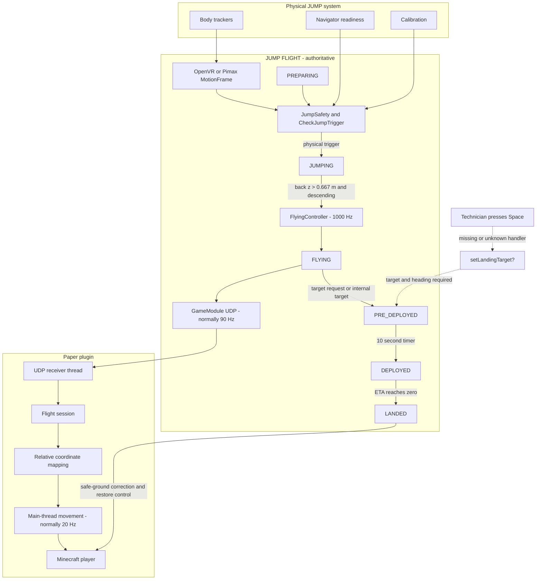

# JUMP to Minecraft MVP Feasibility and Implementation Plan

## Verdict

JUMP-controlled movement in Minecraft is feasible without changing JUMP source code. The exact requested workflow is not yet proven end to end because the production Space-to-landing behavior is absent from the available source.

Confirmed:

- JUMP owns and integrates position, velocity, acceleration, and orientation.
- A replacement game client can receive authoritative flight state through the existing UDP interface.
- Physical launch is observable through UDP lifecycle states without Minecraft issuing a launch command.
- Minecraft can map the relative JUMP trajectory onto a player standing anywhere.
- Unreal is not directly involved in the physical launch state machine.

Unknown or conditional:

- Available physical-mode FLIGHT code does not bind Space to landing.
- A complete scripted landing requires a target position and heading.
- Production UDP binding, calibration ownership, and Navigator interlock settings are absent from this repository.
- The installed Paper 26.3 API could not be inspected because the `mcserver` account and server files were inaccessible from the investigation sandbox.

The exact workflow therefore works with zero JUMP source changes only if an external FLIGHT/launcher component that remains available without Unreal handles Space and sends the existing landing request. If Space was handled by Unreal, Minecraft must reproduce the existing `setLandingTarget` command or provide an equivalent operator action.

No source, configuration, dependencies, server state, or runtime behavior were changed during the investigation.

## Lifecycle



Dashed connections are unverified.

## Physical launch

`PlayerModule` starts in `PLAYER_PREPARING` (`src/server/PlayerModule.cpp:296`). Motion frames update tracker transforms and validate head/back tracking; ML trigger mode additionally requires hands and feet (`PlayerModule.cpp:386-402`).

`JumpSafety` requires readiness, calibration, and tracking to remain healthy continuously for 500 ms (`src/server/JumpSafety.h:5-24`). `PlayerModule::CheckJumpTrigger` applies a back-tracker, HMD, or ML launch detector (`PlayerModule.cpp:1365-1503`). It first changes Navigator state to `fly`, then enters `PLAYER_JUMPING` (`PlayerModule.cpp:1455-1475`).

`PLAYER_JUMPING` becomes `PLAYER_FLYING` when the back tracker passes `z > 0.667` and its filtered vertical velocity is negative (`PlayerModule.cpp:631-664`). UDP output includes `preparing`, `jumping`, and `flying` (`src/server/GameModule.cpp:465-487`).

The trigger has no direct Unreal dependency. Startup can still be game-client-dependent through configuration:

- Navigator heartbeats need `gameId`, `expiresInSeconds`, and `status: 1` for readiness (`src/server/NavModule.cpp:416-495`).
- Readiness leases are capped at three seconds (`src/server/JumpSafety.h:8-14`).
- `nav.require_game_state_interlock=true` requires a localhost `navigatorInterlock` message reporting `Ready` (`NavModule.cpp:664-684`, `GameModule.cpp:166-174`).
- Tracker and stage calibration can arrive through `GameModule` (`GameModule.cpp:182-209`).
- Native Pimax launch checks the current calibration generation (`PlayerModule.cpp:386-402`).

The production configuration is unavailable, so these dependencies must be checked at the facility.

## Spacebar and landing

The only functional Space binding found is desktop/test mode:

- `VK_SPACE` sets `DesktopButtons.jump` (`src/server/DesktopInput.h:50-84`).
- In `PREPARING`, that invokes `StartDesktopJump` (`PlayerModule.cpp:620-628`).
- `StartDesktopJump` refuses to run when Navigator or OpenVR is active (`PlayerModule.cpp:1748-1762`).
- Desktop `P`, not Space, starts canopy deployment.
- `README.txt:20-29` documents Space as Jump and `P` as parachute deployment.

Desktop mode disables Navigator, OpenVR, NatNet, and capture and forces the game socket to loopback (`src/server/Server.cpp:86-103`).

The normal server console handles number keys, `q`, and OpenVR recentering with `r`. It reads `cin >> key`, which skips whitespace, so Space cannot be a console command (`Server.cpp:162-235`, `Server.cpp:321-325`).

### Scripted target landing

The complete landing path begins with:

```json
{
  "setLandingTarget": {
    "target": { "x": 0.0, "y": 0.0, "z": 0.0 },
    "targetheading": 0.0
  }
}
```

It is accepted only when internal target checking is disabled (`src/server/GameModule.cpp:344-357`). It starts a ten-second pre-deployment timer (`PlayerModule.cpp:888-900`), then starts `ParachuteController` with the supplied target and heading (`PlayerModule.cpp:1505-1530`). The controller flies toward that target (`src/server/Controllers.cpp:459-625`) and changes to `PLAYER_LANDED` when ETA reaches zero (`PlayerModule.cpp:1129-1138`). The endpoint is target-driven.

`triggerCanopy.enable=true`, a physical deploy gesture, gamepad input, or desktop `P` starts a separate player-controlled canopy (`PlayerModule.cpp:1533-1604`). It produces `canopy_flying`. No automatic transition from this state to `PLAYER_LANDED` was found.

### Required facility check

Run a passive subscriber and retain FLIGHT/launcher logs during an authorized test. Press Space and determine whether:

- the stream changes to `pre_deployed`;
- FLIGHT logs `setLandingTarget from game`;
- an inbound datagram contains `setLandingTarget`, `triggerCanopy`, or another command;
- the sequence reaches `deployed` and `landed`.

Do not bypass readiness or physical safety interlocks.

## UDP contract

JUMP uses IPv4 UDP through Winsock (`src/util/Net.cpp:64-110`). Defaults are `127.0.0.1:1201`, 90 Hz, and protocol version 2 (`src/server/GameModule.cpp:44-49`). Host parsing accepts dotted IPv4 addresses only (`src/util/Net.cpp:18-29`). Version 1 JSON is selectable with `game.gameframe_version=1` without changing source.

There is no connection handshake or teardown beyond heartbeats and expiry. A practical heartbeat is:

```json
{
  "findex": 1793040000000000,
  "expiresInSeconds": 3,
  "helicopterFlag": false
}
```

`findex` should be monotonically increasing Unix microseconds. Older values are ignored (`GameModule.cpp:385-396`). Although initial validation checks only `findex` and `expiresInSeconds`, the implementation later directly reads `helicopterFlag`; omitting it results in rejection (`GameModule.cpp:398-424`). Send the heartbeat about once per second.

Minimum v1 output fields needed by Minecraft:

```json
{
  "findex": 1793040000123456,
  "state": "flying",
  "pos": { "x": 0.0, "y": 0.0, "z": 0.0 },
  "forward": { "x": 0.0, "y": 0.0, "z": 1.0 },
  "up": { "x": 0.0, "y": 1.0, "z": 0.0 },
  "hasTracking": true,
  "speed": 35.0
}
```

The full schema is serialized at `GameModule.cpp:598-808`. Lifecycle states are defined at `src/server/GameFrame.cpp:46-54`:

```text
not_initialized
preparing
jumping
flying
pre_deployed
deployed
canopy_flying
landed
```

Version 2 sends native `GameFrame2` memory followed by optional JSON (`src/server/GameFrame.h:97-144`, `GameModule.cpp:813-876`). Compiler padding and ABI are not formally specified. Since Minecraft replaces Unreal, version 1 is the safer MVP choice if a configuration change is acceptable.

A loopback bind cannot receive a remote Paper subscription. Production must bind a reachable authorized IPv4 address, or use an explicitly managed local relay. Ordinary game commands are unauthenticated, so access to port 1201 must be restricted to the Paper host.

## Authoritative state and timing

`FlyingPosition` owns `vel`, `oldvel`, and `pos` (`src/server/FlightAttrs.h:19-80`). `FlyingPosition::Execute` calculates gravity, lift, drag, acceleration, velocity, and position (`FlightAttrs.cpp:93-190`). `FlyingRotation::Execute` integrates orientation (`FlightAttrs.cpp:363-398`).

`Server` establishes a 1000 Hz simulation clock (`src/server/Server.cpp:16-84`). `FlyingController::Execute` advances physics on that clock (`src/server/Controllers.cpp:149-213`). Game output is normally 90 Hz; Minecraft should apply only the newest sample at its normal 20 ticks per second.

The exported actor transform is computed at `GameModule.cpp:515-536`:

```cpp
relativeTrans.rot = player->gameTrans.rot * player->xform.rot.Inv();
relativeTrans.pos = player->gameTrans.pos - relativeTrans.rot * player->xform.pos;
```

This is intended for the rendered game actor. Minecraft should use top-level `pos`, `forward`, and `up`, not raw tracker positions.

## Minimal plugin architecture

```text
JumpMinecraftPlugin
├── JumpUdpClient
│   ├── DatagramSocket receive loop
│   ├── heartbeat timer
│   └── strict v1 decoder
├── FlightSessionController
│   ├── armed player UUID
│   ├── lifecycle state
│   ├── Minecraft and JUMP anchors
│   └── stale-data watchdog
├── CoordinateMapper
├── PlayerMotionApplier
│   ├── main-thread movement
│   ├── chunk readiness
│   └── player-state restoration
└── JumpCommand
    ├── arm
    ├── disarm
    └── status
```

UDP receive and heartbeat should run on a background thread and publish a single immutable latest-frame snapshot. All player, world, teleport, gravity, game-mode, and chunk operations must run on the Paper main thread. Select the newest `findex` once per server tick rather than queueing every 90 Hz frame.

The smallest safe association is `/jump arm`. It binds the command sender's UUID, waits without issuing a launch command, captures Minecraft position/world/yaw when `jumping` appears, and captures the JUMP origin and heading on the first valid `flying` frame.

During active control, save and temporarily override the relevant gravity, flight, velocity, fall-distance, and game-mode state. Use position-authoritative movement rather than Elytra controls or Minecraft velocity. Restore everything on `landed`, stale data, disarm, disconnect, plugin disable, reset, or an invalid lifecycle transition.

Avoid overlapping asynchronous teleports. Keep current and look-ahead chunks ready, allow at most one guarded asynchronous load for a discontinuity, and reject late callbacks with a session generation number.

Server-side 20 Hz placement should be mechanically sufficient for an MVP, but visual smoothness is unknown. At 30-45 m/s, motion can exceed one block per tick. Observe this before considering a client mod.

## Coordinate mapping

JUMP uses X right, Y up, Z forward, meters, and degrees (`src/server/PimaxTracking.h:13-19`, `OpenVRModule.cpp:741-744`). Its yaw and pitch functions are (`src/util/MathUtil.cpp:94-100`):

```text
jumpYaw = atan2(-forward.x, forward.z)
jumpPitch = atan2(forward.y, sqrt(forward.x^2 + forward.z^2))
```

Let:

- `M0` be the Minecraft position captured at `jumping`;
- `J0` be the first JUMP `flying` position;
- `minecraftYaw0` be the player's launch yaw;
- `jumpYaw0` be the first JUMP flying yaw;
- `scale` initially be one block per meter;
- `alignment = minecraftYaw0 - jumpYaw0 + configuredHeadingOffset`.

For `d = J(t) - J0`:

```text
rotatedX = cos(alignment) * d.x - sin(alignment) * d.z
rotatedZ = sin(alignment) * d.x + cos(alignment) * d.z

minecraftX = M0.x + scale * rotatedX
minecraftY = M0.y + scale * d.y
minecraftZ = M0.z + scale * rotatedZ
```

Orientation:

```text
minecraftYaw = normalize(jumpYaw + alignment)
minecraftPitch = -atan2(forward.y, sqrt(forward.x^2 + forward.z^2))
```

Minecraft has no normal player roll, so retain `up` for validation but do not try to render roll through player location.

Capture the Minecraft anchor on `jumping`, hold the player until the first `flying` frame, then capture `J0` and alignment. Do not re-anchor at `pre_deployed` or `deployed`; continue the mapping through landing. Accept direct `preparing -> flying` for desktop tests.

## Blockers and risks

| Issue | Classification | Impact |
|---|---|---|
| Production Space binding | **Unknown / blocker** | No physical-mode Space landing handler exists in available source. |
| Landing target | **Confirmed requirement** | Scripted `landed` needs a target and heading. |
| Player canopy | **Confirmed limitation** | Produces `canopy_flying`; no automatic landed transition was found. |
| Production UDP bind | **Unknown / blocker** | Default/repository configuration is loopback-only. |
| Pimax calibration | **Configuration-dependent** | Minecraft or a local launcher may need to supply it. |
| Navigator interlock | **Configuration-dependent** | A localhost launcher may need to keep supplying `Ready`. |
| Paper 26.3 API | **Unknown** | Installed server artifacts were inaccessible. |
| Visual smoothness | **Inferred risk** | Correct 20 Hz movement may look stepped. |
| Unloaded chunks | **Operational risk** | JUMP can cross chunks faster than ordinary play. |
| UDP authentication | **Confirmed absent** | Restrict the port to the Paper host. |
| Minecraft collision | **Excluded from MVP** | JUMP will continue through blocks. |
| Unsafe endpoint | **MVP concern** | Correct to safe ground only after `landed`. |

JUMP has an existing `pushplayer` collision interface and collision-plane handling (`PlayerModule.cpp:1329-1347`, `FlightAttrs.cpp:174-205`), but the MVP should not send collision feedback.

## Validation plan

### Test A: synthetic Linux frames

Generate deterministic v1 frames for:

```text
preparing -> jumping -> flying -> pre_deployed -> deployed -> landed
```

Also inject duplicate, reordered, missing, and stalled frames.

Acceptance criteria:

- only the armed player moves;
- ten JUMP meters produce ten Minecraft blocks at scale one;
- heading begins at the player's launch yaw;
- position error is at most 0.1 block after an applied tick;
- old timestamps never move the player backward;
- no world/entity API is called from the UDP thread;
- restoration occurs within one tick of `landed`;
- stale input, disconnect, and plugin disable restore player state.

### Test B: desktop FLIGHT trajectories

Use the supplied Windows desktop binary/test interface. Windows is its documented environment (`README.txt:39-44`). `Test-DesktopFlightResponse.ps1` already selects v1, sends the heartbeat, injects a jump, and records actual flight-engine behavior.

Run it on Windows, record v1 frames to NDJSON, and replay them into Paper on Linux. A live remote desktop test needs a deliberate local UDP relay because desktop mode enforces loopback. Wine is unverified and should not be a prerequisite.

### Test C: physical facility

1. Verify production bind address and protocol version.
2. Verify calibration and Navigator readiness without Unreal.
3. Subscribe over the authorized network.
4. Observe `preparing -> jumping -> flying` after a physical launch.
5. Press Space in the claimed FLIGHT application.
6. Correlate state changes with logs and, if authorized, inbound packets.
7. Identify the exact landing command and target.
8. Confirm whether the sequence reaches `landed`.

If Space only produces `canopy_flying`, or does nothing without Unreal, the requested workflow is disproven and the Minecraft-side scope needs an operator landing action.

## Implementation sequence

1. Define an immutable frame record and deterministic v1 synthetic sender.
2. Implement a passive subscriber with heartbeat, decoding, ordering, logging, and stale detection.
3. Add one-player `/jump arm`, relative mapping, and main-thread position/orientation movement.
4. Add restoration for `landed`, stale data, disconnect, reset, and plugin disable.
5. Add bounded chunk look-ahead and generation-safe asynchronous completion.
6. Validate recordings from the Windows desktop FLIGHT harness.
7. Validate physical launch, calibration, binding, and Space behavior at the facility.
8. Only after facility evidence, implement the precise existing landing request if Minecraft must replace its missing sender.
9. Assess client smoothness before considering packet-level interpolation or a client mod.

## Smallest next coding task

Build one vertical-slice Paper plugin in `jump_minecraft` that subscribes to synthetic v1 JUMP frames, lets exactly one player run `/jump arm`, captures Minecraft and JUMP origins at launch, applies relative position/yaw/pitch once per server tick, and restores control on `landed`, stale input, disconnect, or plugin shutdown.

The synthetic stream should exercise the complete lifecycle, but the first plugin should send no launch, landing, reset, calibration, or collision commands to JUMP.

This is the shortest path to visible JUMP-controlled flight in Minecraft while preserving JUMP as the sole physics authority and isolating the remaining facility questions: network reachability and what Space actually does.
